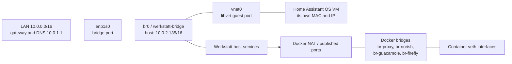

# Werkstatt network



`br0` is the host's LAN connection, not a separate NAT subnet. The physical
port and VM interface are bridge ports; the host's IP, gateway and IPv4 DNS are
configured on the bridge. IPv6 remains automatic. Set Home Assistant's address
inside Home Assistant OS or reserve its own MAC in the DHCP server; it is
independent of the host IP. The old NetworkManager profile `Wired connection 2`
is inactive because `enp1s0` is used by the bridge.

The host bridge profile is declared in `configuration.nix`; GUI changes to it
are not persistent across profile regeneration. The bridge service reapplies the
profile when the expected host IPv4 address is missing, which changes the host
address and can interrupt existing connections. Check that `10.0.2.135` is
reserved and unused before deployment,
and have physical console access available. Verify afterwards:

```sh
ip -br address show br0
ip -4 route
nmcli -g IP4.ADDRESS,IP4.GATEWAY,IP4.DNS device show br0
bridge link
```

Docker's bridges are separate private networks, unlike the LAN bridge. See
[the Compose README](containers/README.md) for their names and veth labels.

## Home Assistant access

On the LAN, open `http://homeassistant.local:8123` or the guest's IP address on
port 8123. On 10 November 2026 the VM reported `10.0.1.80`, so the direct URL
was `http://10.0.1.80:8123`. DHCP can change this address; it is not the
Werkstatt host's address. Home Assistant may redirect the browser to port 80.
For a fresh installation, choose the backup restore option on the onboarding
screen if restoring an existing Home Assistant backup.

On Werkstatt, check the guest's status and LAN address with:

```sh
virsh -c qemu:///system domstate home-assistant
virsh -c qemu:///system domiflist home-assistant
virsh -c qemu:///system domifaddr home-assistant --source agent
```

Use the IPv4 address for the interface whose MAC matches `domiflist`, not the
guest's internal Docker or `hassio` addresses. The address command requires the
guest agent; if it is unavailable, look up the VM's MAC in the router's DHCP
client list. The Home Assistant web interface can take several minutes to start.

For the VM's graphical console, run this from a desktop session on Werkstatt:

```sh
nix shell nixpkgs#virt-manager -c virt-manager --connect qemu:///system --show-domain-console home-assistant
```

The VNC console listens only on Werkstatt's loopback interface, not the LAN.
To configure a static guest address, use Home Assistant's network settings;
alternatively reserve the guest MAC on the router.
